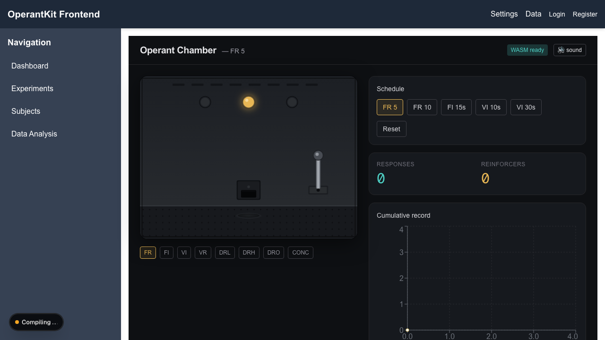

# operantkit-frontend

:jp: [日本語版 README](README.ja.md)

operantkit-frontend is a web interface for [OperantKit](https://github.com/OperantKit), built with Next.js. What works today is a browser operant chamber for teaching, in which you press a lever yourself and a real schedule engine decides each reinforcer, and a page that draws a live cumulative record from a running session. The dashboard, data, settings, and account pages are mock-ups: their API routes return made-up data and are not connected to any experiment.

<p align="center"></p>

## What you see

| Page | What it does now |
|---|---|
| `/sim` | An operant chamber in the browser. Click the lever to respond. FR 5, FR 10, FI 15 s, VI 10 s, and VI 30 s are decided by [contingency-rs](https://github.com/OperantKit/contingency-rs) compiled to WebAssembly; the page counts responses and reinforcers, plays a feeder sound, and draws the cumulative record. The VR, DRL, DRH, DRO, and CONC buttons under the chamber only preview the chamber drawing. |
| `/session-live` | A live cumulative record of a session running elsewhere, read from [session-visualizer](https://github.com/OperantKit/session-visualizer) at `http://127.0.0.1:8765/events` (change it with `NEXT_PUBLIC_SESSION_VISUALIZER_URL`). It only reads; it never sends anything back to the session. |
| `/cumulative-recorder` | A cumulative recorder driven from the keyboard. It needs a backend at `http://127.0.0.1:8765` that is not published in the OperantKit organization; without it, the page shows no data. |
| `/data` | A table, a cumulative record, and a response-rate chart of **mock data**: about ten minutes of random events generated when the server starts, unrelated to any schedule or session. |
| `/settings` | A form for FR, VR, FI, VI, and EXT conditions. Saving keeps the values in the server's memory only; nothing runs them. |
| `/login`, `/register`, `/profile` | Mock accounts. Any non-empty user name and password is accepted, and the name is kept in the browser's local storage. There is no real authentication. |
| `/` | The unmodified Next.js starter page. The sidebar links (Dashboard, Experiments, Subjects, Data Analysis) do not lead anywhere yet. |

### API routes

| Route | What it returns |
|---|---|
| `GET /api/data` | The mock session data shown on `/data` |
| `GET /api/settings` | The settings currently held in memory (the defaults after each restart) |
| `POST /api/settings` | Replaces the settings in memory; they are lost when the server stops |

Neither route reads or writes any OperantKit package or file.

## Installation

You need Node.js (the repository pins version 24 in `.mise.toml`), npm, and Rust with [wasm-pack](https://rustwasm.github.io/wasm-pack/). `package.json` takes the schedule engine from a WebAssembly build of contingency-rs at `../../core/contingency-rs/pkg`, so the two repositories must sit in that layout:

```bash
mkdir -p core softwares   # in an empty folder
git clone https://github.com/OperantKit/contingency-rs core/contingency-rs
git clone https://github.com/OperantKit/operantkit-frontend softwares/operantkit-frontend
cd softwares/operantkit-frontend
npm run wasm:build   # builds ../../core/contingency-rs/pkg with wasm-pack
npm ci
npm run build
```

Without the WebAssembly build, `npm ci` stops with `ENOENT: Could not read package.json` for `core/contingency-rs/pkg`. The first `wasm:build` took about seven minutes.

Then start the development server and open http://localhost:3000/sim:

```bash
npm run dev
```

Use `localhost`, not `127.0.0.1`. The development server blocks some of its resources for other host names, and when the page was opened at `127.0.0.1` the chamber never showed "WASM ready".

## Limitations

- **Most pages are mock-ups.** Only `/sim` and `/session-live` show real schedule behavior or real session data. Do not use `/data` or `/settings` for an experiment.
- **No standalone install.** The frontend cannot be installed from a single clone because of the `file:` dependency on contingency-rs.
- **The browser chamber measures time in the browser.** Response times come from the page's clock and are not suitable for timing-critical work.

AI coding assistants working on this repository should read [AGENTS.md](AGENTS.md).

## Development

```bash
npm run lint
npx tsc --noEmit
npx playwright install chromium   # once
npm test                          # Playwright end-to-end tests
```

## License

The repository does not include a license file yet.
